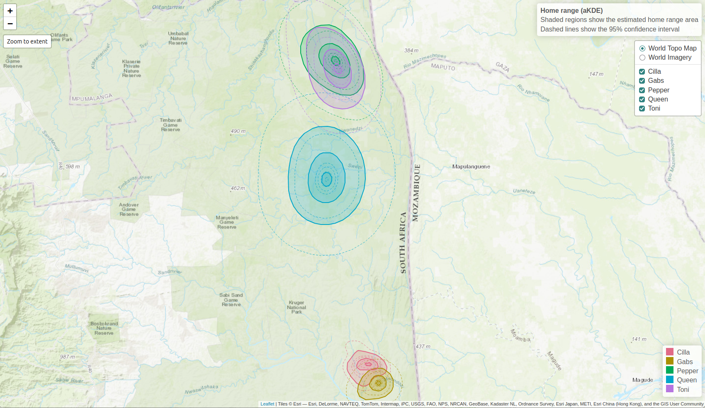

# Autocorrelated Kernel Density Estimate (aKDE)

MoveApps

GitHub repository: https://github.com/movestore/ctmm_akde

  

## Description
Use a fitted continuous-time movement model (CTMM) to estimate the home
ranges of a set of tracked animals using autocorrelated kernel density
estimation (aKDE) at one or more isopleth levels.

## Documentation
Autocorrelated kernel density estimates (aKDEs) are estimates of the range
distribution of range-resident animals. Unlike conventional kernel density
estimates, they take into account the autocorrelation of tracking data, using
the CTMM fitted to each animal.

This App calculates one utilization distribution (UD) per animal in the input
data. It then derives the contours for the provided isopleth levels from each
of those distributions, along with its 95% confidence interval. These results
are provided in several forms:

- an interactive map of the home ranges of all animals on a basemap
- a PDF containing static maps of all animals' home ranges at the given isopleth
  levels as well as each animal's individual home range
- a table containing the numerical area of each home range
- the home range contours as a GeoPackage
- the UDs as image raster files

The UDs are also passed on to the next App in the Workflow.

This App is part of a `ctmm` Workflow. You must run the *Fit a
Continuous-Time Movement Model (ctmm)* App before this one, as its output is
necessary to calculate the aKDE estimates.

See the [ctmm vignette on aKDEs][1] for more information on interpreting the
home range estimates.

[1]: https://cran.r-project.org/web/packages/ctmm/vignettes/akde.html

### Application scope
#### Generality of App usability
This App was developed for any taxonomic group that displays range-resident
behavior.

#### Required data properties
This App is only applicable to data that reflect range-resident behavior. Use
the *Variogram* App to evaluate whether this property holds for your data.
Animals whose movement model is not range-resident are left out (see
[Errors and null handling](#errors-and-null-handling)).

### Input type
`ctmm model with data`: a list with two elements:

1. `model`: a list containing the selected `ctmm` model for each animal.
2. `data`: the tracking data (an object of type `telemetry.list`).

### Output type
`ctmm ud with data`: a list with three elements:

1. `model`: the list of `ctmm` models from the input.
2. `uds`: a list containing the aKDE UD (an object of class `UD`) for each
   animal.
3. `data`: the tracking data from the input (an object of type
   `telemetry.list`).

### Artefacts
The contours, areas, plots and map are created for each isopleth level given
in the **Isopleth level(s)** setting. The confidence intervals are always 95%
confidence intervals.

`akde_map.html`: an interactive map of the home ranges of all animals, as a
single HTML file that can be opened in a web browser. The map shows each animal's
home range and 95% confidence interval contours for each of the requested
isopleth levels.

`akde_plots.pdf`: static plots of the home ranges, including an overall plot
with all animals as well as plots for each animal individually.

`akde_summary.csv`: the estimated home range area (and 95% confidence interval)
of each animal at each isopleth level. It contains the following columns:
  - `id`: the name of the animal.
  - `level`: the isopleth level.
  - `parameter`: the parameter name and its unit (always `area (square
    meters)`, so that areas are comparable across animals and levels).
  - `low`, `est`, `high`: the estimated area and the lower and upper bounds of
    its confidence interval.

`homerange.gpkg`: a GeoPackage with the home range contours of all animals as
polygons. Each animal has three polygons per isopleth level: the estimate and
the lower and upper bounds of its confidence interval. It contains the following
columns:
  - `id`: the name of the animal.
  - `level`: the isopleth level.
  - `estimate`: which contour the polygon is: `est` (the estimate), `low` or
    `high` (the bounds of its confidence interval).
  - `name`: the contour name given by `ctmm`, e.g. "Cilla 95% est".

The coordinates are in the local map projection that ctmm uses for the
tracking data.

`uds.zip`: a zip archive with one GeoTIFF file per animal (`<animal>.tif`)
containing its UD on a raster grid. Each cell's value is the probability that
the animal will be found within the contour line passing through that cell.
The coordinates are in the local map projection that ctmm uses for the
tracking data.

### Settings
**Isopleth level(s) (`isopleth_levels`):** The desired home range coverage
levels to compute. Each level should be a number between 0 and 1. If multiple
are provided, separate them with commas. Each value gives the smallest
area in which the animal has the given probability of being present. For
instance, 0.95 would represent the area within which there is a 95% probability
that the animal will be present. By default, uses `0.5, 0.95` to calculate the
50% and 95% coverage levels.

### Changes in output data
The App adds the aKDE UD of each animal to the input data (see
[Output type](#output-type)). The models and tracking data remain unchanged,
except that animals without a home range estimate are removed from all three
elements of the output (see [Errors and null handling](#errors-and-null-handling)).

### Errors and null handling
**Setting `Isopleth level(s)`:** If the setting is empty, or if any value is
not a number strictly between 0 and 1, the App stops with an error message
that names the invalid value(s). A common mistake is to enter a percentage
instead of a proportion (e.g. 95 instead of 0.95) or to separate values with
something other than commas (e.g. spaces).

**Animals without a home range estimate:** aKDE is not defined for animals
whose movement model is not range-resident, or whose track is too short to
cover the range (the model then has no area degrees of freedom). These
animals are left out of all artefacts and of the output passed to the next
App, so that models, UDs and tracking data stay aligned. A warning will alert
you if any animals have been removed in this way. If all animals are removed,
the App stops with an error.

**Many isopleth levels:** Plots and maps become hard to read with many
levels, as the contours of nearby levels overlap and their colours become
similar. Two or three levels are recommended.

### Technical details
The UDs are calculated with [`ctmm::akde()`][2], with all animals in a single
call and with the function's default settings. Each animal's UD is based on
its own fitted model.

The contours are calculated with `ctmm::SpatialPolygonsDataFrame.UD()` and the
areas with ctmm's `summary()` method for UDs, at each isopleth level. The
rasters are written with ctmm's `writeRaster()` method for UDs. The PDF plots
use ctmm's `plot()` method; the map is made with the `leaflet` package.

Note: ctmm 1.3.x does not mark holes within a contour. This App identifies
nested contour rings so that areas inside the outer contour that are not part
of the home range area at the selected isopleth level are left out of the
output polygons.

On the map only, the contour coordinates are rounded to about 1 m to keep the
HTML file small. The GeoPackage keeps the full precision.

The aKDE method is described in Fleming, C. H., Fagan, W. F., Mueller, T.,
Olson, K. A., Leimgruber, P., & Calabrese, J. M. (2015). Rigorous home range
estimation with movement data: A new autocorrelated kernel density estimator.
*Ecology*, 96(5), 1182–1188. https://doi.org/10.1890/14-2010.1

The `ctmm` package is described in Calabrese, J. M., Fleming, C. H., &
Gurarie, E. (2016). ctmm: An R package for analyzing animal relocation data as
a continuous-time stochastic process. *Methods in Ecology and Evolution*,
7(9), 1124–1132. https://doi.org/10.1111/2041-210X.12559

[2]: https://ctmm-initiative.github.io/ctmm/reference/akde.html
